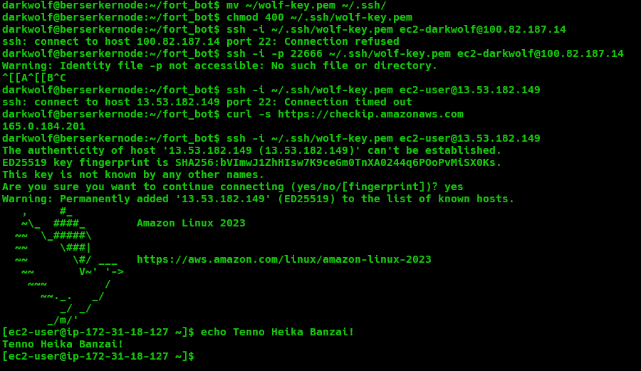

# Lab 1: Launch and connect to an EC2 web server

> First server in the cloud. Took six attempts to get in, and every failure taught me something.

## What I built
- An **Amazon Linux 2023** EC2 instance (`t3.micro`) in **eu-north-1 (Stockholm)**
- An ED25519 key pair (`wolf-key.pem`), stored on my home server with `chmod 400`
- A security group allowing SSH only from specific IPs (`/32`) and HTTP from anywhere
- SSH access from my home server (berserkernode) to the instance

## Commands I used

```bash
# Copy the private key from my work PC to my home server (note the colon!)
scp -P <port> C:\Users\<me>\Downloads\wolf-key.pem darkwolf@<home-server>:~/

# Lock the key down. SSH refuses keys other users can read
mv ~/wolf-key.pem ~/.ssh/
chmod 700 ~/.ssh
chmod 400 ~/.ssh/wolf-key.pem

# Find my home server's public IP for the security group
curl -s https://checkip.amazonaws.com

# Connect
ssh -i ~/.ssh/wolf-key.pem ec2-user@<EC2-PUBLIC-IP>

# Set the CLI to the region I actually launched in
aws configure set region eu-north-1
```

## What broke and how I fixed it

| # | What I did | What happened | Root cause | Fix |
|---|---|---|---|---|
| 1 | `scp ... darkwolf@<home-server>` | "1 file(s) copied", but no file on the server | No `:` after the host, so scp did a **local** copy on Windows | Added `:~/` to the destination, then deleted the stray local copy |
| 2 | `chmod 700 ssh` | No error, but wrong target | `~/ssh` is a stray empty file; the real folder is the hidden `~/.ssh` | `chmod 700 ~/.ssh` |
| 3 | `ssh ... ec2-darkwolf@<home-server>` | `Connection refused` | Connected to my **own** server on port 22 (mine listens on a custom port). Wrong host and wrong user | Used the EC2 public IP and the default user `ec2-user` |
| 4 | `ssh -i -p <port> ~/.ssh/wolf-key.pem ...` | `Identity file -p not accessible` | `-i` takes the **next word** as the key file | Keep options paired: `-i <key> -p <port>` |
| 5 | `ssh ... ec2-user@<EC2-IP>` | `Connection timed out` | The security group only allowed my **work** IP, saved when I chose "My IP" in the browser at work | Added an inbound SSH rule for my home IP `/32` |
| 6 | `aws ec2 describe-instances` (planned) | Would have returned nothing | The instance is in eu-north-1, but my CLI defaulted to eu-west-1 | `aws configure set region eu-north-1` |

## Lessons
> [!TIP]
> **Timed out = firewall / security group. Refused = reached the host, but nothing listening on that port.**

- Check the region in the top-right corner of the console before creating anything.
- "My IP" in the console means the IP of wherever you're browsing from, not the server you'll connect from.
- Private keys never stay on a work machine. Copy, then delete, and empty the Recycle Bin.
- The first-connection fingerprint prompt saves the server's identity to `~/.ssh/known_hosts`. The fingerprint is public, not a secret.

## Screenshots


## Still to do
- [ ] Patch the instance (`sudo dnf update -y`)
- [ ] Install nginx and serve a page
- [ ] Break and fix the security group on purpose
- [ ] Terminate the instance
